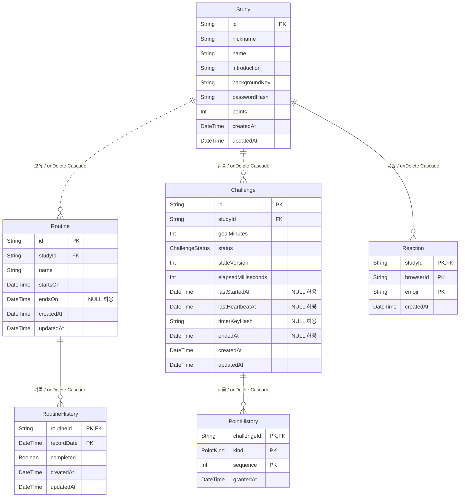
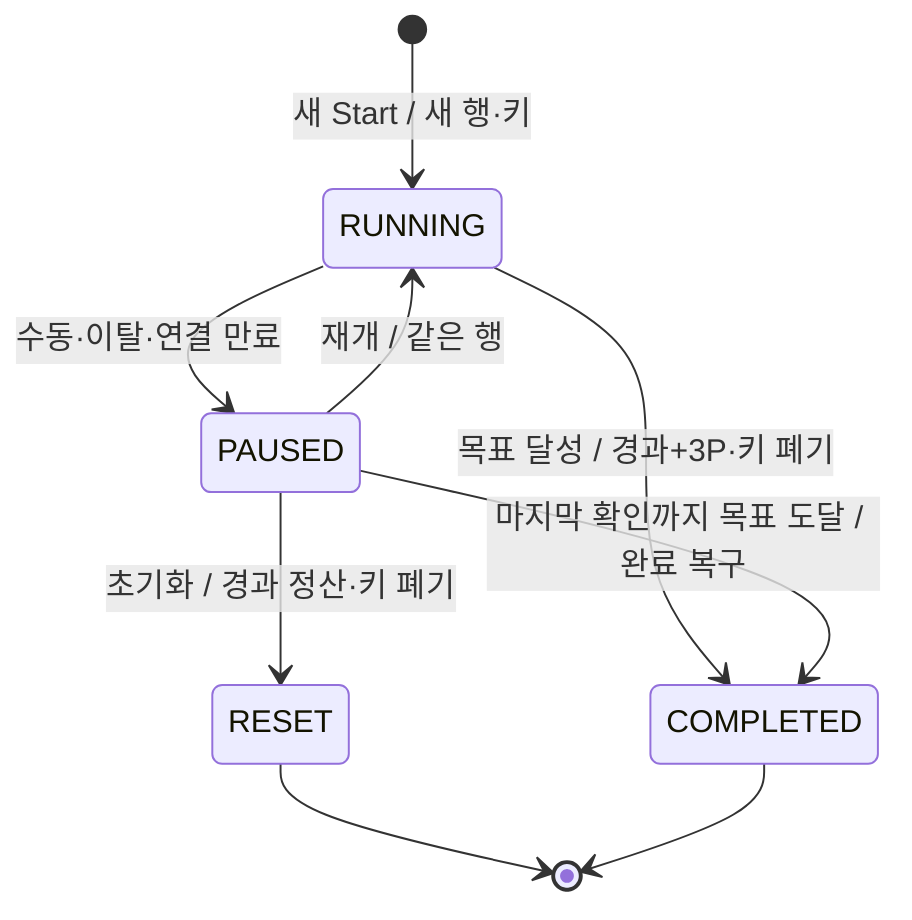

# 공부의 숲 데이터베이스 설계

- 버전:0.6 통합 검토 초안 · 2026-10-10 (Asia/Seoul)
- 기준: [README.md](README.md), [API.md](API.md), [ADR.md](ADR.md) ADR-043~048.
- 스키마: [api/prisma/schema.prisma](api/prisma/schema.prisma). 6개 테이블을 유지하고 VerificationToken·회원 테이블은 만들지 않는다.
- 이번에는 문서·스키마만 갱신한다. 기존 데이터 변경·migration·generate·db push를 실행하지 않는다.

## 로컬 실행 환경 — ADR-049·050

- Neon 호스팅 이전 개발용 PostgreSQL은 루트 `compose.yaml`의 `postgres:18` (18 계열 태그, 18.6 고정 아님)을 사용한다.
- DB·사용자 `forest-of-study`, 로컬 전용 비밀번호 `forest-of-study-local`.
- 로컬 앱/DB 클라이언트의 접속 주소는 `127.0.0.1:5435`. 컨테이너 내부 포트는5432다.
- named volume `forest-of-study-data`는 `/var/lib/postgresql`에 연결한다. 데이터는 컨테이너와 분리해 보존한다.
- 컨테이너 이름은 `forest-of-study-db`다. 포트 매핑 `5435:5432`는 루프백 바인딩으로 제한하지 않는다. healthcheck는 `pg_isready`, 간격 10초·제한 5초·재시도 5회·시작 유예 10초다.
- 기존 `postgres_data`의 데이터는 새 볼륨으로 자동 이전되지 않는다. 초기 계정 설정은 빈 데이터 디렉터리에서만 적용되므로 기존 볼륨의 계정은 자동 변경되지 않는다.
- 설정 파일 작성만 완료했으며 컨테이너 시작·접속·migration은 실행하지 않았다. 테이블·FK·CHECK가 실제 생성됐다는 의미가 아니다.
- ISS-001은 로컬 DB 설정, ISS-005는 이후 migration·제약 적용이다. 기존 미정 정책 확인은 ISS-002다.
- 실행 순서·기대 결과는 README.md의 ‘로컬 DB 개발 환경’을 따른다. Neon 배포 접속 정보는 로컬 개발 설정과 별도로 관리한다.

## 1. 구조와 저장 기준

| 테이블 | 역할 | 주 식별자 |
| --- | --- | --- |
| Study | 기본 정보·bcrypt 해시·지급 총점 | id |
| Routine | 반복 습관과 시작/종료일 | id |
| RoutineHistory | 한국 날짜별 완료/해제 상태 | routineId + recordDate |
| Challenge | 집중1회의 시간·상태·타이머 키 해시 | id |
| PointHistory | 해당 집중의 중복 없는 지급 근거 | challengeId + kind + sequence |
| Reaction | 브라우저·이모지별1회 응원 | studyId + browserId + emoji |

- 비밀번호 원문·일반 인증 토큰·타이머 원문 키는 DB에 저장하지 않는다.
- 일반 인증은 서버 서명 토큰의 studyId·서명·만료를 확인한다. 한국 자정 만료, LocalStorage 보관·재접속 유지. 서버 비밀은 환경변수이며 토큰 테이블은 없다.
- 타이머 전용 키의 해시를 Challenge.timerKeyHash에 저장한다. 키가 조작권이며 browserId는 응원 중복 방지에만 쓴다. 키를 가진 같은 브라우저 프로필 탭들은 같은 권한이다.
- 타이머 키는 자정에도 유지하고 RESET/COMPLETED에서 null로 폐기한다. 분실 복구 시 비밀번호를 다시 검증하고 해시를 교체해 이전 키를 무효화한다.
- 모든 습관 날짜는 서버가 Asia/Seoul로 계산한 Date. 일시는 timestamptz(3), 클라이언트에 UTC ISO 문자열로 전달한다.
- Study.points는 실제 지급 합계의 조회용 중복 저장이다. 진행·정지 중 미정산 경과는 포함하지 않는다.

## 2. 전체 ERD

dotted 관계는 부모 FK가 자식 PK의 일부가 아닌 관계, solid 관계는 부모 FK가 자식 PK에 포함된 관계다. 모든 FK는 필수이며 onDelete: Cascade다.



## 3. 관계차수·선택사양·삭제 동작

| 관계 | 관계차수 | 부모1행의 자식 수 | 자식1행의 부모 수 | 부모 측 선택 | 자식 측 선택 | FK | onDelete |
| --- | --- | --- | --- | --- | --- | --- | --- |
| Study → Routine | 1:N | 0..N | 1..1 | 선택 | 필수 | Routine.studyId NOT NULL | Cascade |
| Routine → RoutineHistory | 1:N | 0..N | 1..1 | 선택 | 필수 | RoutineHistory.routineId NOT NULL | Cascade |
| Study → Challenge | 1:N | 0..N | 1..1 | 선택 | 필수 | Challenge.studyId NOT NULL | Cascade |
| Challenge → PointHistory | 1:N | 0..N | 1..1 | 선택 | 필수 | PointHistory.challengeId NOT NULL | Cascade |
| Study → Reaction | 1:N | 0..N | 1..1 | 선택 | 필수 | Reaction.studyId NOT NULL | Cascade |

Study→Challenge의0..N은 전체 이력이다. RUNNING/PAUSED 활성만0..1로 제한하며 전체 관계를1:1로 바꾸지 않는다. RESET/COMPLETED는 이력으로 남는다. 타이머 키의 선택성은 활성에서 필수·종료에서null이며 별도 엔터티 관계가 아니다.

스터디 물리 삭제는 연결된 모든 행을 Cascade 삭제한다. 습관 종료는 Routine.endsOn만 변경해 이력을 보존한다. 타이머 초기화는 Challenge를 RESET으로 종료하고 원장도 보존하므로 Cascade를 실행하지 않는다.

## 4. 데이터 사전

NULL 여부·기본값·Prisma 자료형은 아래 스키마 선언과 대응한다. UUID id는 서버/DB 생성 기본값이며 DB 네이티브 길이·날짜·타임스탬프는 선언의 @db를 따른다.

### Study

| 컬럼 | Prisma 선언 | NULL |
| --- | --- | --- |
| id | `String   @id @default(uuid()) @db.Uuid` | 불가 |
| nickname | `String   @db.VarChar(10)` | 불가 |
| name | `String   @db.VarChar(15)` | 불가 |
| introduction | `String   @db.VarChar(100)` | 불가 |
| backgroundKey | `String   @default("green") @db.Text` | 불가 |
| passwordHash | `String   @db.Text` | 불가 |
| points | `Int      @default(0)` | 불가 |
| createdAt | `DateTime @default(now()) @db.Timestamptz(3)` | 불가 |
| updatedAt | `DateTime @updatedAt @db.Timestamptz(3)` | 불가 |

### Routine

| 컬럼 | Prisma 선언 | NULL |
| --- | --- | --- |
| id | `String    @id @default(uuid()) @db.Uuid` | 불가 |
| studyId | `String    @db.Uuid` | 불가 |
| name | `String    @db.VarChar(20)` | 불가 |
| startsOn | `DateTime  @db.Date` | 불가 |
| endsOn | `DateTime? @db.Date` | 허용 |
| createdAt | `DateTime  @default(now()) @db.Timestamptz(3)` | 불가 |
| updatedAt | `DateTime  @updatedAt @db.Timestamptz(3)` | 불가 |

### RoutineHistory

| 컬럼 | Prisma 선언 | NULL |
| --- | --- | --- |
| routineId | `String   @db.Uuid` | 불가 |
| recordDate | `DateTime @db.Date` | 불가 |
| completed | `Boolean  @default(false)` | 불가 |
| createdAt | `DateTime @default(now()) @db.Timestamptz(3)` | 불가 |
| updatedAt | `DateTime @updatedAt @db.Timestamptz(3)` | 불가 |

### Challenge

| 컬럼 | Prisma 선언 | NULL |
| --- | --- | --- |
| id | `String          @id @default(uuid()) @db.Uuid` | 불가 |
| studyId | `String          @db.Uuid` | 불가 |
| goalMinutes | `Int             @default(10)` | 불가 |
| status | `ChallengeStatus @default(RUNNING)` | 불가 |
| stateVersion | `Int @default(1)` | 불가 |
| elapsedMilliseconds | `Int             @default(0)` | 불가 |
| lastStartedAt | `DateTime?       @db.Timestamptz(3)` | 허용 |
| lastHeartbeatAt | `DateTime?       @db.Timestamptz(3)` | 허용 |
| timerKeyHash | `String?         @db.VarChar(64)` | 허용 |
| endedAt | `DateTime?       @db.Timestamptz(3)` | 허용 |
| createdAt | `DateTime        @default(now()) @db.Timestamptz(3)` | 불가 |
| updatedAt | `DateTime        @updatedAt @db.Timestamptz(3)` | 불가 |

### PointHistory

| 컬럼 | Prisma 선언 | NULL |
| --- | --- | --- |
| challengeId | `String    @db.Uuid` | 불가 |
| kind | `PointKind` | 불가 |
| sequence | `Int` | 불가 |
| grantedAt | `DateTime  @default(now()) @db.Timestamptz(3)` | 불가 |

### Reaction

| 컬럼 | Prisma 선언 | NULL |
| --- | --- | --- |
| studyId | `String   @db.Uuid` | 불가 |
| browserId | `String   @db.Uuid` | 불가 |
| emoji | `String   @db.Text` | 불가 |
| createdAt | `DateTime @default(now()) @db.Timestamptz(3)` | 불가 |

### 컬럼 의미와 파생값

- Study.nickname/name/introduction 최대10/15/100, Routine.name 최대20. 문자열 공백·글자 수 기준은 API-Q-06에서 확정한다. DB varchar와 프론트 글자 수가 다를 수 있으므로 이모지 경계도 검증한다.
- Study.backgroundKey 기본green은 첫 초록색. 총8종(원색4·이미지4) 키·자산 목록은 추후 전달받는다. API background와 명시적으로 매핑한다.
- Study.passwordHash는 bcrypt, points 기본0·음수 금지. 닉네임·이름 중복 UNIQUE는 미정 정책을 임의 확정하지 않기 위해 추가하지 않는다.
- Routine.startsOn/endsOn은 양 끝 포함. 종료일이null이면 열린 기간이다. 종료 즉시 오늘 목록에서 숨기고 체크·이름 변경 금지. 생성 당일 종료도 유효하며 startsOn=endsOn 허용.
- RoutineHistory.completed=false 행은 체크 해제 사실로 남긴다. 유효 날짜에 행이 없으면 조회 시false, 유효 기간 밖은 exists=false/completed=null. 이름은 Routine에서 조회하여 과거 표에도 현재 이름 반영.
- Challenge.goalMinutes10~180 정수·기본10. elapsedMilliseconds는 확정된 실행 구간의 누적. RUNNING일 때만 lastStartedAt을 사용한다. lastHeartbeatAt은 마지막 유효 서버 확인 시각이며 정지/종료 뒤에도 근거로 보존할 수 있다.
- Challenge.endedAt은 실제 종료 전이 확정 시각이며 목표 도달 예정시각과 다르다. COMPLETED와RESET만 필수. timerKeyHash는 SHA-256의64자리16진수이며 활성 필수·종료null. 원문 키는 시작/복구 응답에만 전달한다.
- PointHistory.ELAPSED sequence=1,2,…는 각각10,20,…분의1P, GOAL sequence=0은3P. 금액은 kind에서 파생하며 amount 컬럼은 없다. 집중 행1개가 시도1회이므로 attemptNumber는 제거한다.
- Reaction.createdAt을 이모지별 MIN으로 집계해 최초 반응 시각을 구한다. 상위3종은 COUNT DESC, MIN(createdAt) ASC, emoji ASC(C collation). browserId는 일반 중복 방지 수준이며 신원 증명이 아니다.

## 5. 정규화와 총점 중복 저장

| 단계 | 적용 |
| --- | --- |
| 1NF | 습관 날짜·지급·응원을 각각 독립 행으로 저장. 배열/반복 컬럼 없음 |
| 2NF | RoutineHistory의 상태는 routineId+날짜 전체, Reaction의 시각은 studyId+browserId+emoji 전체, PointHistory의 시각은 지급 복합키 전체에 종속 |
| 3NF 목표 | 과거 기록에 습관 이름·studyId를 복사하지 않고 FK로 조회. PointHistory에 스터디 이름·목표 시간을 복사하지 않음 |

Study.points는 사용자 선택에 따른 **조회 성능 목적의 합계 중복 저장**이다. 전체 구조를 중복 없는 정규화 결과라고 설명하지 않는다. 지급 근거는 PointHistory이고 points는 같은 트랜잭션으로 유지해야 하는 합계다. 날짜별 이름 복제나 불필요한 이행 종속은 추가하지 않는다.

| 테이블 | 결정자 | 비키 속성 |
| --- | --- | --- |
| Study | id | nickname, name, introduction, backgroundKey, passwordHash, points, createdAt, updatedAt |
| Routine | id | studyId, name, startsOn, endsOn, createdAt, updatedAt |
| RoutineHistory | routineId, recordDate | completed, createdAt, updatedAt |
| Challenge | id | studyId, goalMinutes, status, stateVersion, elapsedMilliseconds, lastStartedAt, lastHeartbeatAt, timerKeyHash, endedAt, createdAt, updatedAt |
| PointHistory | challengeId, kind, sequence | grantedAt |
| Reaction | studyId, browserId, emoji | createdAt |

상위 응원·남은 시간·진행 일수는 파생 조회한다. 총점은 원장 합계와 대조 가능해야 하며 어긋나면 원장을 근거로 별도 복구한다. 운영 중 자동 덮어쓰기 작업은 이번 범위에 추가하지 않는다.

## 6. 상태·기간·정산 규칙

### 습관 표시와 조작

- 오늘 목록: endsOn IS NULL AND startsOn <= 한국 오늘.
- 기록 칸: startsOn <= 날짜 AND (endsOn IS NULL OR 날짜 <= endsOn).
- 주간 행: startsOn <= 주 마지막날 AND (endsOn IS NULL OR endsOn >= 주 첫날).
- 오늘 생성→체크→종료도 오늘 체크는 남고 목록에서만 제거된다. 지난달 종료 습관이 이번 주 빈 행으로 나오지 않는다.
- endsOn은 종료 시 최초 오늘 날짜로만 설정하며 재삭제로 날짜를 바꾸지 않는다. 날짜가 유효해도 종료된 습관 조작은 거절한다.
- 최대18개는 킥오프 요구이며 활성/전체 범위는 미정. 현재 DB 이력 관계의0..N에 총18개 제한을 붙이지 않는다.

### 집중 생명주기



READY·attemptNumber·completedAt은 새 모델에서 제거하고 endedAt으로 종료 전이를 표현한다. reset 뒤 다음 Start는 새 행이므로 이전 행 상태를 되돌리지 않는다. 활성 행이 없으면 가장 최근 RESET/COMPLETED의goalMinutes로 시작 전 목표를 복원한다. 없으면10분이다. 새 시작의 경과는0이고 이전 나머지를 이월하지 않는다.

### 포인트 무결성

- 초기화: floor(확정 경과/600000)P. 완료: 같은 경과 보상+3P. 목표 초과분 제외, 상한 없음. 정지·재개·조회·heartbeat에는 지급 없음.
- 한 트랜잭션에서 Study→Challenge 잠금 → 상태/권한/경과 검사 → 신규 원장 행 삽입 → 신규 지급만 Study.points에 원자적 증가 → RESET/COMPLETED·endedAt·키null 확정.
- 같은 (challengeId,kind,sequence)는1회만 기록한다. 기존 행 충돌 후 무조건 총점 증가 금지. 종료 재확인은 신규0P.
- Study 행 잠금은 새 시작·지급·습관 개수 검사에서 같은 순서로 사용해 교착 위험을 줄인다. 시작 동시성은 부분 UNIQUE도 함께 사용한다.
- 타이머 키 폐기 뒤 종료 재확인은 API의 일반 토큰 전용 동일 동작 재요청을 사용한다. 완료 후 다른 초기화로 보상 종류를 바꿀 수 없다.

### 연결 만료·키 복구

15초 heartbeat, 마지막 확인 후90초 이상이면 만료(ADR-047). 인증·소속 확인 뒤 집중 요청에서 만료를 먼저 검사한다. 유효한 RUNNING만 서버 현재 시각을 쓰고, 만료 시에는 저장 경과 + max(0,lastHeartbeatAt-lastStartedAt)을 목표로 제한하여 PAUSED·lastStartedAt null·stateVersion+1로 확정한다. 지급 없음, 키 유지. 늦은 heartbeat는 재개하거나 확인 시각을 연장하지 않는다.

자정은 일반 인증 토큰만 만료한다. 타이머·확정 경과·타이머 키는 날짜와 관계없이 유지한다. 일시정지도 계속 활성1개에 포함한다. 키 분실 복구는 비밀번호 재검증 후 같은 행의 키 해시만 교체한다. 만료 복구가 필요하면 먼저 수행하며 자동 재개하지 않는다.

## 7. 제약·인덱스와 후속 migration

Prisma에는 PK·FK·NULL·varchar·일반 인덱스를 표현했다. 아래 SQL은 별도 migration에서 적용할 설계이며 이번에 실행하지 않는다. DB CHECK는 다른 행이나 원장 합계의 일관성까지 보장하지 못하므로 총점은 트랜잭션으로 보장한다. [PostgreSQL 제약](https://www.postgresql.org/docs/current/ddl-constraints.html)

```sql
CREATE UNIQUE INDEX "Challenge_one_active_per_study"
ON "Challenge" ("studyId")
WHERE "status" IN ('RUNNING', 'PAUSED');

ALTER TABLE "Study"
ADD CONSTRAINT "Study_points_nonnegative" CHECK ("points" >= 0);

ALTER TABLE "Routine"
ADD CONSTRAINT "Routine_period" CHECK ("endsOn" IS NULL OR "startsOn" <= "endsOn"),
ADD CONSTRAINT "Routine_name_nonempty" CHECK (char_length("name") >= 1);

ALTER TABLE "Challenge"
ADD CONSTRAINT "Challenge_state_version_positive" CHECK ("stateVersion" >= 1),
ADD CONSTRAINT "Challenge_goal_range" CHECK ("goalMinutes" BETWEEN 10 AND 180),
ADD CONSTRAINT "Challenge_elapsed_range"
  CHECK ("elapsedMilliseconds" BETWEEN 0 AND "goalMinutes" * 60000),
ADD CONSTRAINT "Challenge_running_time" CHECK (
  ("status" = 'RUNNING' AND "lastStartedAt" IS NOT NULL AND "lastHeartbeatAt" IS NOT NULL
   AND "lastHeartbeatAt" >= "lastStartedAt")
  OR ("status" <> 'RUNNING' AND "lastStartedAt" IS NULL)
),
ADD CONSTRAINT "Challenge_terminal" CHECK (
  ("status" IN ('COMPLETED','RESET') AND "endedAt" IS NOT NULL AND "timerKeyHash" IS NULL)
  OR ("status" IN ('RUNNING','PAUSED') AND "endedAt" IS NULL AND "timerKeyHash" IS NOT NULL)
),
ADD CONSTRAINT "Challenge_key_format"
  CHECK ("timerKeyHash" IS NULL OR "timerKeyHash" ~ '^[0-9a-f]{64}$'),
ADD CONSTRAINT "Challenge_completed_elapsed"
  CHECK ("status" <> 'COMPLETED' OR "elapsedMilliseconds" = "goalMinutes" * 60000);

ALTER TABLE "PointHistory"
ADD CONSTRAINT "PointHistory_kind_sequence" CHECK (
  ("kind" = 'ELAPSED' AND "sequence" BETWEEN 1 AND 18)
  OR ("kind" = 'GOAL' AND "sequence" = 0)
);
```

보상sequence가 해당 집중 확정 경과를 넘지 않는지, GOAL이COMPLETED에만 있는지는 서버 트랜잭션에서 함께 확인한다. Study 필수 문자열의 공백·글자 계산 기준은 확정 후 검증을 맞춘다.

| 인덱스/키 | 목적 |
| --- | --- |
| Study(createdAt,id), (points,id) | 생성 순·총점 순 정렬 |
| Routine(studyId,startsOn,endsOn) | 오늘/주간 기간 조회 |
| RoutineHistory PK | 날짜별 중복 방지 |
| Challenge(studyId,status) + 활성 부분 UNIQUE | 단일 활성·동시 시작 방어 |
| Challenge(studyId,createdAt,id) | 마지막 목표 복원 |
| PointHistory PK | 지급 중복 방지 |
| Reaction PK, (studyId,emoji) | 브라우저 중복·응원 집계 |

## 8. 변경 적용·검증과 미정

기존 DB가 있다면 Study.points를 원장 합계로 채우고, 기존 attempt별 Challenge/PointHistory를 새 행별 이력으로 전환하는 절차가 필요하다. READY 제거·attemptNumber 제거·completedAt→endedAt·키 해시 추가는 파괴적 자동변환을 하지 않는다. 실행 환경·데이터 존재를 확인한 뒤 migration 계획을 별도로 검토한다. 지금은 테이블 생성/변환을 수행하지 않는다.

Prisma CLI 설치·validate·generate·migrate·db push는 실행하지 않았다. 모델6개·FK5개·ERD/사전/스키마 대응, 토큰 테이블 제외, 활성 상태·기간·지급 키를 정적으로 대조한다. 연결 설정·클라이언트 생성기는 후속 구현 범위이며 추가 라이브러리는 사용자 지정 없이 설치하지 않는다.

남은 결정: 습관18개 범위, 중복 스터디 정책, 배경7종 키·자산, 공백·글자 계산·이모지 동일성, 기본 주/조회 범위·색상표, 기기별 Heartbeat 지연 검증. 자세한 목록은 API.md10절과 issues.md에 연결한다.

## 9. 담당 탭·버전·습관 쓰기 보완 (ADR-047~048)

탭 담당 선정은 브라우저 내부 관리이며 새 테이블/FK를 추가하지 않는다. 키 소유권은 같은 프로필 단위로 유지한다. 담당 탭만15초 확인을 보내며 종료/새로고침 시 다른 탭이 이어받는다. 모든 사이트 탭의 연결이90초 끊기면 후속 요청에서 마지막 확인 시각 기준으로 정지한다. 종료 이벤트의 즉시pause는 하지 않는다. 관계차수·선택사양·Cascade는 동일하다.

Challenge.stateVersion은 실제 상태 전환·자동 만료·키 복구마다1증가한다. 활성 키 조작/heartbeat는 전달된 버전을 잠금 안에서 검사한다. 오래된 정지/heartbeat가 재개된 실행 구간을 바꾸지 못한다. heartbeat 자체는 버전을 올리지 않고 현재 서버 확인 시각만 갱신한다. API의 만료 발견 heartbeat200과 terminal 재확인 예외는 API.md12절을 따른다.

습관 체크·이름 수정·종료는 Study→Routine 잠금 순서를 통일하여 종료 상태 검사와쓰기를 원자적으로 처리한다. 먼저 확정된 체크는 보존, 종료 뒤 체크·수정은 거절한다. 기존 데이터에 stateVersion을 적용하는 migration도 후속 구현이며 이번에 실행하지 않는다.

PointHistory의 kind·sequence를 ERD·데이터 사전에 복원했다. 스키마의 복합PK(challengeId,kind,sequence)와 일치한다.
