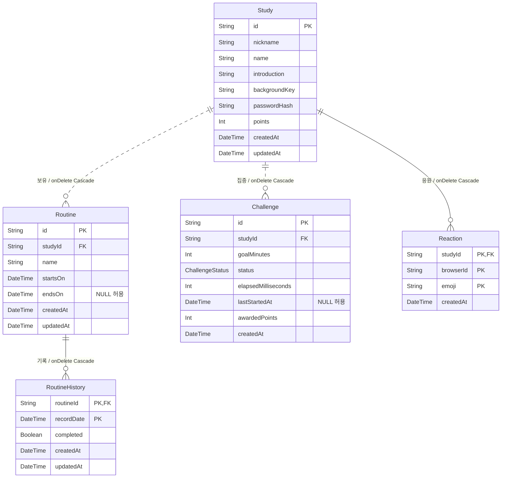
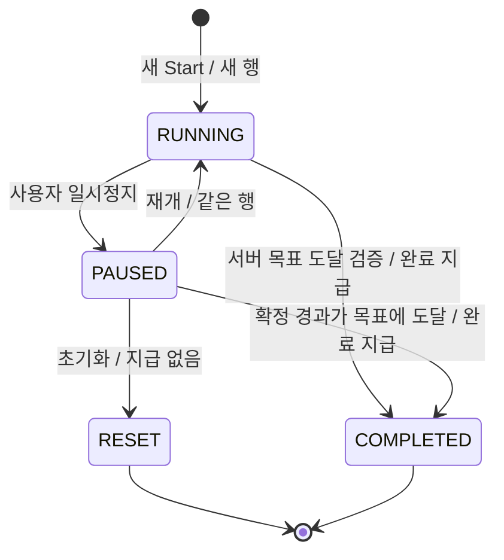

# 공부의 숲 데이터베이스 설계

- 버전:0.13 킥오프 결정 동기화 · 2026-10-20 (Asia/Seoul)
- 기준: [README.md](../README.md), [API.md](API.md), [ADR.md](ADR.md) ADR-051~073; 최신 후속 결정을 우선 적용한다.
- 스키마: [api/prisma/schema.prisma](../api/prisma/schema.prisma). 5개 테이블을 사용한다. VerificationToken·PointHistory·회원 테이블은 만들지 않는다.
- 이번 작업은 명세만 갱신한다. 기존 스키마·애플리케이션 코드·데이터·migration 파일은 변경하지 않으며 CLI·DB·API는 실행하지 않는다.

## 로컬 실행 환경 — ADR-049·050

- Neon 호스팅 이전 개발용 PostgreSQL은 루트 `compose.yaml`의 `postgres:18` (18 계열 태그, 18.6 고정 아님)을 사용한다.
- DB·사용자 `forest-of-study`, 로컬 전용 비밀번호 `forest-of-study-local`.
- 로컬 앱/DB 클라이언트의 접속 주소는 `127.0.0.1:5435`. 컨테이너 내부 포트는5432다.
- named volume `forest-of-study-data`는 `/var/lib/postgresql`에 연결한다. 데이터는 컨테이너와 분리해 보존한다.
- 컨테이너 이름은 `forest-of-study-db`다. 포트 매핑 `5435:5432`는 루프백 바인딩으로 제한하지 않는다. healthcheck는 `pg_isready`, 간격 10초·제한 5초·재시도 5회·시작 유예 10초다.
- 기존 `postgres_data`의 데이터는 새 볼륨으로 자동 이전되지 않는다. 초기 계정 설정은 빈 데이터 디렉터리에서만 적용되므로 기존 볼륨의 계정은 자동 변경되지 않는다.
- 설정·migration 파일은 작성돼 있다. 이번 문서 작업에서는 컨테이너 시작·접속·migration 실행 여부를 확인하지 않았다. 파일 존재만으로 테이블·FK·CHECK의 실제 생성 완료를 뜻하지 않는다.
- ISS-001은 로컬 DB 설정, ISS-005는 이후 migration·제약 적용이다. 기존 미정 정책 확인은 ISS-002다.
- 실행 순서·기대 결과는 README.md의 ‘4.3 PostgreSQL 실행’을 따른다. Neon 배포 접속 정보는 로컬 개발 설정과 별도로 관리한다.

## 1. 구조와 저장 기준

| 테이블 | 역할 | 주 식별자 |
| --- | --- | --- |
| Study | 기본 정보·bcrypt 해시·지급 총점 | id |
| Routine | 반복 습관과 시작/종료일 | id |
| RoutineHistory | 한국 날짜별 완료/해제 상태 | routineId + recordDate |
| Challenge | 집중 1회의 시간·상태·완료 지급량 | id |
| Reaction | 브라우저·이모지별1회 응원 | studyId + browserId + emoji |

- 비밀번호 원문은 DB·LocalStorage·쿠키·URL·로그에 저장하지 않는다. Study.passwordHash만 bcrypt 해시로 저장한다.
- 비밀번호가 앱 메모리에 없으면 API로 확인하고 내부 보호 페이지 이동 중 유지한다. 새로고침·앱 종료 후에는 다시 입력한다(ADR-073). 보호 요청마다 X-Study-Password로 bcrypt 검증하며 최초 확인·삭제는 본문 password를 사용한다. 앱 메모리의 보관 구조는 DB 모델이 아니다.
- 토큰·타이머 키·브라우저 소유권은 사용하지 않는다. 응원 browserId는 응원 중복 방지에만 사용한다.
- RUNNING은 브라우저 종료·외부 이동·새로고침과 무관하게 서버 시간으로 계속 흐른다. 자동 일시정지·연결 확인·연결 만료·stateVersion은 제외한다.
- 모든 습관 날짜는 서버가 Asia/Seoul로 계산한 Date. 일시는 timestamptz(3), 클라이언트에 UTC ISO 문자열로 전달한다.
- Study.points는 완료된 Challenge.awardedPoints 합계의 중복 저장이다. 진행·정지·초기화에는 포인트를 지급하지 않는다.

## 2. 전체 ERD

dotted 관계는 부모 FK가 자식 PK의 일부가 아닌 관계, solid 관계는 부모 FK가 자식 PK에 포함된 관계다. 모든 FK는 필수이며 onDelete: Cascade다.



## 3. 관계차수·선택사양·삭제 동작

| 관계 | 관계차수 | 부모1행의 자식 수 | 자식1행의 부모 수 | 부모 측 선택 | 자식 측 선택 | FK | onDelete |
| --- | --- | --- | --- | --- | --- | --- | --- |
| Study → Routine | 1:N | 0..N | 1..1 | 선택 | 필수 | Routine.studyId NOT NULL | Cascade |
| Routine → RoutineHistory | 1:N | 0..N | 1..1 | 선택 | 필수 | RoutineHistory.routineId NOT NULL | Cascade |
| Study → Challenge | 1:N | 0..N | 1..1 | 선택 | 필수 | Challenge.studyId NOT NULL | Cascade |
| Study → Reaction | 1:N | 0..N | 1..1 | 선택 | 필수 | Reaction.studyId NOT NULL | Cascade |

Study→Challenge의0..N은 전체 이력이다. RUNNING/PAUSED 활성만0..1로 제한하며 전체 관계를1:1로 바꾸지 않는다. RESET/COMPLETED는 이력으로 남는다. Challenge.lastStartedAt은 RUNNING에서 필수이고 나머지 상태에서는 null이다.

스터디 물리 삭제는 연결된 모든 행을 Cascade 삭제한다. 습관 종료는 Routine.endsOn만 변경해 이력을 보존한다. 타이머 초기화는 Challenge를 RESET으로 종료해 이력을 보존하며 Cascade를 실행하지 않는다. 전체 5개 테이블·4개 FK다.

## 4. 데이터 사전

NULL 여부·기본값·Prisma 자료형은 아래 스키마 선언과 대응한다. UUID id는 서버/DB 생성 기본값이며 DB 네이티브 길이·날짜·타임스탬프는 선언의 @db를 따른다.

### Study

| 컬럼 | Prisma 선언 | NULL |
| --- | --- | --- |
| id | `String   @id @default(uuid()) @db.Uuid` | 불가 |
| nickname | `String   @db.Text` | 불가 |
| name | `String   @db.Text` | 불가 |
| introduction | `String   @db.Text` | 불가 |
| backgroundKey | `String   @default("green") @db.Text` | 불가 |
| passwordHash | `String   @db.Text` | 불가 |
| points | `Int      @default(0)` | 불가 |
| createdAt | `DateTime @default(now()) @db.Timestamptz(3)` | 불가 |
| updatedAt | `DateTime @updatedAt @db.Timestamptz(3)` | 불가 |

### Routine

| 컬럼 | Prisma 선언 | NULL |
| --- | --- | --- |
| id | `String    @id @default(uuid()) @db.Uuid` | 불가 |
| studyId | `String    @db.Uuid` | 불가 |
| name | `String    @db.Text` | 불가 |
| startsOn | `DateTime  @db.Date` | 불가 |
| endsOn | `DateTime? @db.Date` | 허용 |
| createdAt | `DateTime  @default(now()) @db.Timestamptz(3)` | 불가 |
| updatedAt | `DateTime  @updatedAt @db.Timestamptz(3)` | 불가 |

### RoutineHistory

| 컬럼 | Prisma 선언 | NULL |
| --- | --- | --- |
| routineId | `String   @db.Uuid` | 불가 |
| recordDate | `DateTime @db.Date` | 불가 |
| completed | `Boolean  @default(false)` | 불가 |
| createdAt | `DateTime @default(now()) @db.Timestamptz(3)` | 불가 |
| updatedAt | `DateTime @updatedAt @db.Timestamptz(3)` | 불가 |

### Challenge — 8개 컬럼

| 컬럼 | Prisma 선언 | NULL | 의미 |
| --- | --- | --- | --- |
| id | `String @id @default(uuid()) @db.Uuid` | 불가 | 집중 1회의 ID |
| studyId | `String @db.Uuid` | 불가 | 소속 스터디 |
| goalMinutes | `Int @default(10)` | 불가 | 목표 시간, 10~180분 정수 |
| status | `ChallengeStatus @default(RUNNING)` | 불가 | RUNNING / PAUSED / RESET / COMPLETED |
| elapsedMilliseconds | `Int @default(0)` | 불가 | 이전 실행 구간에서 확정한 누적 시간 |
| lastStartedAt | `DateTime? @db.Timestamptz(3)` | 허용 | 현재 실행 구간의 시작 시각, RUNNING에서만 사용 |
| awardedPoints | `Int @default(0)` | 불가 | 완료 시 지급한 포인트, 미완료·초기화는 0 |
| createdAt | `DateTime @default(now()) @db.Timestamptz(3)` | 불가 | 생성 시각·마지막 목표 복원 정렬 |

### Reaction

| 컬럼 | Prisma 선언 | NULL |
| --- | --- | --- |
| studyId | `String   @db.Uuid` | 불가 |
| browserId | `String   @db.Uuid` | 불가 |
| emoji | `String   @db.Text` | 불가 |
| createdAt | `DateTime @default(now()) @db.Timestamptz(3)` | 불가 |

### 컬럼 의미와 파생값

- Study.nickname/name/introduction은 trim 후 그래핌 기준 1~10/1~15/1~100개, Routine.name은 1~20개다. 빈 문자열·공백만 있는 입력은 거절하고 정리한 문자열을 저장한다. Intl.Segmenter를 사용해 조합 이모지도 각각 1글자로 센다. 네 컬럼은 TEXT로 저장해 DB의 문자 길이 제한과 충돌하지 않게 한다. 최대 그래핌 수는 서버에서 검사하며 프론트에서도 같은 기준으로 안내한다(ADR-056~057).
- Study.backgroundKey 기본green은 첫 초록색. 총8종(원색4·이미지4) 중 나머지 7종의 임시 키·자산은 담당자가 지정·공유하고 추후 변경한다. API와 프론트는 같은 목록을 쓴다. TEXT 타입을 유지하며 최종 목록 변경 시 기존 저장값 매핑을 함께 검토한다.
- Study.passwordHash는 bcrypt, points 기본0·음수 금지. 비밀번호·확인값은 공백을 제거하거나 trim하지 않고 원문으로 4~20자·`/^[A-Za-z0-9!@#$%^&*]+$/`를 검사한다. 앞뒤·중간 공백, 탭, 줄바꿈이 포함되면 400 VALIDATION_ERROR로 거절한다. 생성은 각 값의 형식·두 값의 일치를 확인한 뒤 유효한 비밀번호 원문만 해시하고 모든 검증 API도 원문 형식 검사 후 bcrypt 비교한다(ADR-066). DB에는 평문을 저장하지 않고 해시만 저장한다. nickname·name은 trim 후 저장값의 조합이 같은 스터디를 허용하지 않는다. Study의 @@unique([nickname,name])로 보장하며 단일 nickname 또는 단일 name만 같은 것은 허용한다. 생성·수정 충돌은 409 STUDY_CONFLICT로 매핑한다(ADR-064).
- Routine.startsOn/endsOn은 양 끝 포함. 종료일이null이면 열린 기간이다. 종료 즉시 오늘 목록에서 숨기고 체크·이름 변경 금지. 생성 당일 종료도 유효하며 startsOn=endsOn 허용.
- 습관 18개 제한은 studyId별 endsOn IS NULL인 행만 센다. 종료 행과 RoutineHistory는 개수에 포함하지 않는다. 일괄 저장의 종료·개수 검사·생성을 Study 잠금 안의 같은 트랜잭션으로 처리한다. 종료 반영 후 미종료 개수가 18개를 넘지 않아야 한다. 행 합계 제한을 단일 행 CHECK로 대신하지 않는다.
- 오늘 목록과 주간 기록 행은 createdAt ASC → id ASC다(ADR-056·060). 사용자 순서 변경은 후속 ISS-031이며 이번 스키마에 position/order 컬럼을 추가하지 않는다.
- RoutineHistory.completed=false 행은 체크 해제 사실로 남긴다. 유효 날짜에 행이 없으면 조회 시false, 유효 기간 밖은 completed=null이다. 주간 API의 dates·exists·행별 startsOn/endsOn은 응답에서 제외하되 DB 기간 컬럼과 종료일 포함 조회 규칙은 유지한다. 이름은 Routine에서 조회해 과거 표에도 현재 이름을 반영한다(ADR-060).
- Challenge.goalMinutes는 목표 **길이**, lastStartedAt은 **시각**이다. 서로 대체할 수 없다. elapsedMilliseconds는 일시정지 전에 실제로 진행한 구간의 누적 시간이다.
- RUNNING의 실제 경과 = min(goalMinutes × 60000, elapsedMilliseconds + max(0, 서버 현재 시각 - lastStartedAt)). PAUSED/RESET/COMPLETED의 경과는 저장된 elapsedMilliseconds다.
- 조회마다 진행 중 시간을 DB에 덧셈하지 않는다. 일시정지할 때 실제 경과를 저장하고 lastStartedAt=null, 재개할 때 기존 경과를 유지하고 lastStartedAt=서버 현재 시각으로 설정한다.
- awardedPoints는 완료 지급의 결과다. COMPLETED 전이는 서버가 목표 도달을 검증한 뒤 수행한다. RESET은 경과 이력을 보존하지만 지급하지 않는다. 새 시작은 새 행·경과 0이며 예전 행을 재사용하지 않는다.
- Reaction.emoji는 피부색 수정자를 제거한 기본 이모지다(👍·👍🏽·👍🏻 → 👍). 정규화한 emoji로 PK 중복 검사와 집계를 수행한다. 선택기의 모든 이모지를 허용하고 별도 색상·정규화 키 컬럼은 추가하지 않는다(ADR-064).
- Reaction.createdAt을 기본 이모지별 MIN으로 집계해 최초 반응 시각을 구한다. 집계 정렬은 COUNT DESC, MIN(createdAt) ASC, emoji ASC(C collation)다. 상세·등록 응답은 전체 집계, ID 다건 조회는 상위 3종을 사용한다(ADR-072). browserId는 일반 중복 방지 수준이며 신원 증명이 아니다.

## 5. 정규화와 총점 중복 저장

| 단계 | 적용 |
| --- | --- |
| 1NF | 습관의 날짜별 상태·집중 1회·응원을 독립 행으로 저장하며 배열/반복 컬럼을 두지 않는다 |
| 2NF | RoutineHistory의 상태는 routineId+날짜 전체, Reaction의 시각은 studyId+browserId+emoji 전체에 종속한다 |
| 3NF 목표 | 과거 기록에 습관 이름·studyId를 복사하지 않고 FK로 조회한다. 집중에 스터디 이름·비밀번호를 복사하지 않는다 |

| 테이블 | 결정자 | 비키 속성 |
| --- | --- | --- |
| Study | id | nickname, name, introduction, backgroundKey, passwordHash, points, createdAt, updatedAt |
| Routine | id | studyId, name, startsOn, endsOn, createdAt, updatedAt |
| RoutineHistory | routineId, recordDate | completed, createdAt, updatedAt |
| Challenge | id | studyId, goalMinutes, status, elapsedMilliseconds, lastStartedAt, awardedPoints, createdAt |
| Reaction | studyId, browserId, emoji | createdAt |

Challenge.awardedPoints는 집중별 지급 결과를 보관한다. 별도 PointHistory와 PointKind는 제거한다. Study.points는 이 지급량의 합계를 빠르게 조회·정렬하기 위한 의도적인 중복 저장이므로 전체 구조가 중복 없는 정규화 결과라고 설명하지 않는다. 지급 전이와 합계 증가를 같은 트랜잭션으로 처리한다.

Study.points = COALESCE(SUM(해당 스터디 Challenge.awardedPoints), 0)을 대조 기준으로 사용한다. 자동 보정 작업·별도 포인트 관리 API는 이번 범위에 추가하지 않는다. 응원 집계·남은 시간·진행 일수는 조회 시 파생한다.

## 6. 상태·기간·정산 규칙

### 습관 표시와 조작

- 오늘 목록: endsOn IS NULL AND startsOn <= 한국 오늘.
- 기록 칸: startsOn <= 날짜 AND (endsOn IS NULL OR 날짜 <= endsOn).
- 주간 행: startsOn <= 주 마지막날 AND (endsOn IS NULL OR endsOn >= 주 첫날).
- 오늘 생성→체크→종료도 오늘 체크는 남고 목록에서만 제거된다. 지난달 종료 습관이 이번 주 빈 행으로 나오지 않는다.
- endsOn은 일괄 저장의 종료 처리 시 최초 한국 오늘 날짜로 설정하고 재종료로 바꾸지 않는다. 날짜가 유효해도 종료된 습관의 체크·이름 변경은 거절한다.
- 최대 18개는 `endsOn IS NULL`인 습관에만 적용한다. 종료된 습관·날짜별 기록은 제외하며 DB 이력 관계는 0..N을 유지한다. 오늘 목록은 `createdAt ASC → id ASC`로 반환한다.

### 집중 생명주기



- RUNNING/PAUSED는 스터디당 합계 1개다. PAUSED가 있으면 새 시작을 막고 기존 집중을 재개하거나 초기화한다.
- 브라우저를 닫아도 RUNNING은 계속 흐른다. 별도 Heartbeat·자동 일시정지·소유권·stateVersion은 사용하지 않으며 여러 브라우저의 조작 순서 충돌 처리는 이번 범위에서 제외한다.
- 초기화는 PAUSED에서만 가능하다. 행을 삭제하지 않고 RESET으로 종료한다. 화면은 해당 목표 시간·경과 0의 시작 전 상태로 돌아가며 자동 시작하지 않는다. 다음 Start에서 새 행을 만든다.
- 활성 행이 없으면 최신 RESET/COMPLETED의 goalMinutes를 복원한다(createdAt DESC, id DESC). 이력도 없으면 10분이다. 이전 집중의 남은 시간을 새 집중에 이월하지 않는다.
- 목표에 도달해도 GET은 상태·지급을 변경하지 않는다. 클라이언트가 완료 요청을 보내 서버가 검증하고 종료한다. 창이 닫힌 동안 목표를 채웠다면 재접속 후 앱 메모리에 비밀번호가 없으면 확인하고 완료 보호 요청으로 지급한다. 완료 처리 전까지 그 행은 활성 슬롯을 차지한다.

### 완료 포인트와 중복 지급 방지

- 완료 지급량 = floor(goalMinutes / 10) + 3. 10/20/25/180분 완료는 4/5/5/21P이며 상한 없음.
- 일시정지·재개·초기화·조회에는 지급하지 않는다. 13분 초기화 후 다른 집중을 17분 초기화해도 합계 0P다.
- Study→Challenge 순서로 잠금 → 현재 상태/소속/서버 경과 검사 → RUNNING/PAUSED 행만 COMPLETED로 **조건부 전환** → elapsedMilliseconds를 목표 값, lastStartedAt을 null, awardedPoints를 지급량으로 설정 → Study.points 원자 증가를 한 트랜잭션으로 처리한다.
- 실제로 완료 전이에 성공한 요청만 총점을 증가시킨다. 트랜잭션만 감싸고 무조건 증가시키지 않는다. 실패 시 상태·지급량·총점 모두 롤백한다.
- 동일 COMPLETED 행의 완료 재요청은 200·이번 신규 지급 0P이며 기존 awardedPoints와 총점을 보존한다. RESET에 완료 요청은 거절한다.
- 여러 브라우저의 조작 순서 보장을 제외해도 완료 요청 반복·더블클릭에 대한 중복 지급 방지는 유지한다.

### 습관 일괄 저장과 쓰기 무결성

체크와 일괄 저장은 Study→Routine 잠금 순서로 상태 검사와 쓰기를 묶는다. 생성·이름 변경·종료를 일괄 저장하며 실패 시 일부 변경을 남기지 않는다. 종료 후 활성 개수로 18개 제한을 검사하고 재종료는 최초 종료일을 보존한다. 먼저 확정된 체크는 기록표에 남기고 종료 뒤 체크·수정은 거절한다. ‘수정 완료’ 한 번의 변경을 API-HB-06으로 저장하고 성공 시 최신 오늘 목록을 반환한다. 세부 요청 검증·응답은 API.md 6절을 따른다.

## 7. 제약·인덱스와 migration

Prisma에는 PK·FK·NULL·문자열 타입·인덱스와 Study(nickname,name) 복합 UNIQUE를 선언한다. 복합 UNIQUE SQL은 `20261015000100_study_nickname_name_unique/migration.sql`에 존재하며 실제 DB 적용 여부는 별도 확인한다. 아래 CHECK·부분 UNIQUE에 대응하는 migration SQL 파일은 이미 저장소에 있다. 파일 존재와 실제 DB 적용은 구분하며 이번에는 실행 상태를 확인하지 않았다. 최대 그래핌 수와 활성 습관 18개는 서버에서 검사한다. CHECK는 다른 행 합계의 일관성을 보장하지 않으므로 총점은 위 트랜잭션으로 유지한다.

```sql
CREATE UNIQUE INDEX "Challenge_one_active_per_study"
ON "Challenge" ("studyId")
WHERE "status" IN ('RUNNING', 'PAUSED');

ALTER TABLE "Study"
ADD CONSTRAINT "Study_points_nonnegative" CHECK ("points" >= 0);

ALTER TABLE "Routine"
ADD CONSTRAINT "Routine_period" CHECK ("endsOn" IS NULL OR "startsOn" <= "endsOn"),
ADD CONSTRAINT "Routine_name_nonempty" CHECK (char_length("name") >= 1);

ALTER TABLE "Challenge"
ADD CONSTRAINT "Challenge_goal_range" CHECK ("goalMinutes" BETWEEN 10 AND 180),
ADD CONSTRAINT "Challenge_elapsed_range"
  CHECK ("elapsedMilliseconds" BETWEEN 0 AND "goalMinutes" * 60000),
ADD CONSTRAINT "Challenge_running_time" CHECK (
  ("status" = 'RUNNING' AND "lastStartedAt" IS NOT NULL)
  OR ("status" <> 'RUNNING' AND "lastStartedAt" IS NULL)
),
ADD CONSTRAINT "Challenge_award_state" CHECK (
  ("status" = 'COMPLETED'
    AND "elapsedMilliseconds" = "goalMinutes" * 60000
    AND "awardedPoints" = ("goalMinutes" / 10) + 3)
  OR ("status" <> 'COMPLETED' AND "awardedPoints" = 0)
);
```

| 인덱스/키 | 목적 |
| --- | --- |
| Study(nickname,name) UNIQUE — migration 파일 존재·적용 확인 필요 | 같은 닉네임·스터디 이름 조합 중복 방지 |
| Study(createdAt,id), (points,id) | 생성 순·총점 순 정렬 |
| Routine(studyId,startsOn,endsOn) | 오늘/주간 기간 조회 |
| RoutineHistory PK | 날짜별 중복 방지 |
| Challenge(studyId,status) + 활성 부분 UNIQUE | 단일 활성·동시 시작 방어 |
| Challenge(studyId,createdAt,id) | 마지막 목표 복원 |
| Reaction PK, (studyId,emoji) | 피부색 제거 후 기본 이모지 기준의 브라우저 중복·응원 집계 |

## 8. 변경 적용·검증과 미정

기존 DB에 데이터가 있다면 PointHistory의 기존 지급 기록과 Study.points를 먼저 대조하고, 과거 초기화 보상까지 새 완료 전용 정책에 어떻게 처리할지 별도로 확인해야 한다. 기존 지급 내역을 새 awardedPoints로 기계적으로 복사하거나 삭제하지 않는다. 과거 RESET 지급 행이 있으면 새 CHECK와 충돌할 수 있다. 데이터 존재·전환 정책을 확인하기 전 파괴적 migration을 적용하지 않는다.

현재 저장소에는 5개 모델 생성·CHECK·Cascade·활성 부분 UNIQUE를 정의한 migration 파일이 있다. 이번 작업은 명세 업데이트뿐이며 Prisma CLI validate·generate·migration·실제 DB 검증을 실행하지 않았다. 파일이 있다는 사실만으로 적용 완료로 표시하지 않는다.

### 킥오프 후속 스키마 변경 — ADR-056~057

Study.nickname/name/introduction과 Routine.name을 TEXT로 변경했다. 길이 제한 자체를 없애는 것이 아니라, 최대 그래핌 수 검증을 서버가 맡도록 저장 타입을 변경한 것이다. NOT NULL과 기존 Routine_name_nonempty는 유지한다. DB를 직접 수정하거나 별도 스크립트로 저장할 때도 같은 입력 규칙을 지켜야 한다.

TEXT 변경 migration은 `20261013000100_routine_name_text`와 `20261014000100_grapheme_text`에 작성돼 있다. 후자는 Study의 세 컬럼과 Routine.name을 TEXT로 변경한다. Routine.name 변경이 앞 파일과 겹치지만 이번에는 기존 이력을 수정하지 않는다. 적용 담당자는 실제 DB의 migration 상태를 확인하고 기존 파일을 적용·검증한다. 비밀번호 입력 검증·쿼리·조회 정책에는 추가 테이블/컬럼이 필요하지 않다. ADR-066의 공백 포함 요청 거절도 스키마·migration 변경이 필요하지 않다. ADR-064의 Study 복합 UNIQUE migration은 `20261015000100_study_nickname_name_unique`에 존재한다. 이번에는 적용하지 않았다.

후속 검증 기준: 조합 이모지로 닉네임10·이름15·소개100·습관20그래핌 저장 성공, 각 제한+1과 trim 후 빈 문자열 거절, 활성 18개 생성 거절·종료 후 생성 성공, 생성일 순 조회, 생성·진입 확인·삭제·보호 요청에서 비밀번호 또는 확인값의 앞뒤·중간 공백·탭·줄바꿈을 400으로 거절하고, 공백 없는 유효한 비밀번호의 생성·검증이 일치하는지 확인. 이번에는 실제 명령·API·DB 검증을 실행하지 않았다.

확정: 같은 nickname/name 조합 중복 금지·409 STUDY_CONFLICT, 모든 이모지 허용·피부색 변형의 기본 이모지 통합, 목록최대6·최근 3개·생성일 1일째, 목록순18색 순환 배정이다(ADR-064·065). 남은 자료: 배경색·이미지,18개 색상값, 반응형·습관 편집 캡처다. 후속 사용자 정렬 저장 방식은 별도 검토한다. 목록 기본값·검색 규칙·주간 날짜 보정/행 순서/조회 기간·다건 10개 상한은 ADR-059·060·063으로 확정했다. 안내 문구는 최종 확정 전 임시 구현을 허용한다.


## 9. 새 정책의 후속 적용 — ADR-064·065

- Study 복합 UNIQUE 적용 전에 기존 nickname/name 조합 중복을 조사하고 데이터가 있다면 정리 방안을 별도로 확인한다. 기존 행을 임의 삭제·덮어쓰지 않는다.
- 기존 Reaction에 피부색별 행이 있으면 기본 이모지로 변환할 때 PK 충돌·집계 차이가 생길 수 있다. 새 저장 규칙 적용과 기존 데이터 전환을 구분하고 승인된 전환 계획 전에는 기존 데이터를 자동 변경하지 않는다.
- 최근 조회 3개는 LocalStorage·표시 규칙, 진행 일수 1일째와 목록순18색은 파생·프론트 규칙이다. 이를 위해 DB 컬럼·테이블을 추가하지 않는다.


## 10. 10.16~10.20 결정의 저장 영향

- 습관 생성·수정·종료는 일괄 저장으로 전환한다. 개별 API-HB-02/03/04는 폐기하고 기존 Routine·RoutineHistory 모델과 종료일·기록 보존 규칙을 유지한다. 새 모델·컬럼은 추가하지 않는다.
- 비밀번호 앱 메모리는 클라이언트 수명 관리다. DB에는 passwordHash만 저장하며 토큰·검증 테이블은 만들지 않는다.
- 상세·응원 등록의 전체 집계와 ID 다건 조회의 상위 3종은 같은 Reaction의 조회 범위 차이다. DB에 집계 배열을 저장하지 않는다.
- Header 여백·소개 전체 표시·모달 취소·json-server 도입에는 DB 스키마 변경이 없다. 임시 데이터는 실제 PostgreSQL 검증을 대신하지 않는다.
